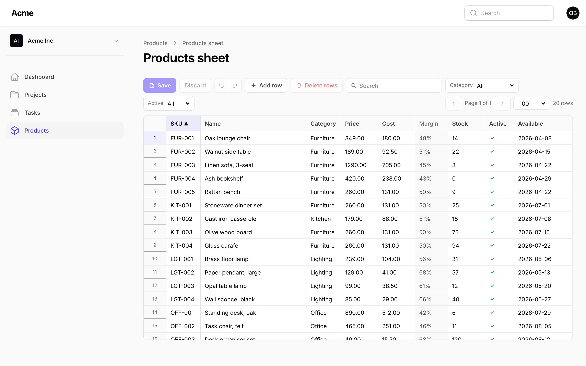
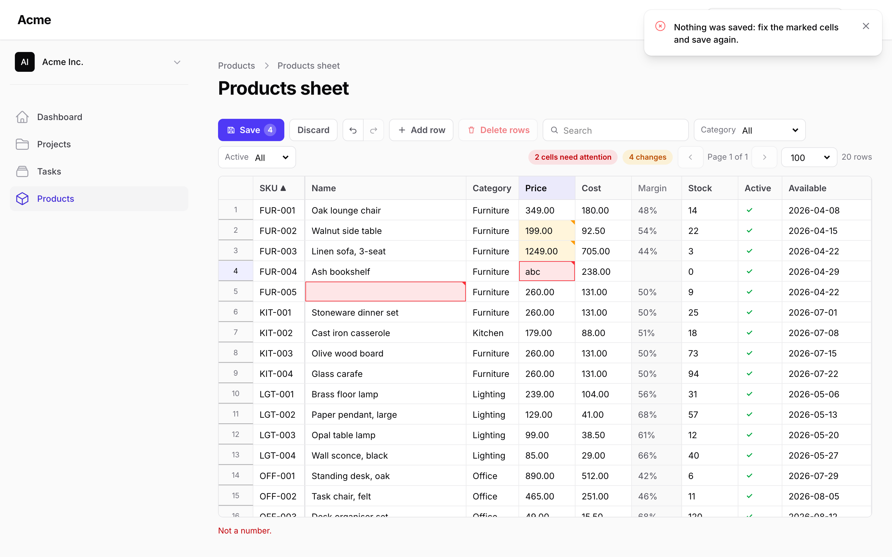
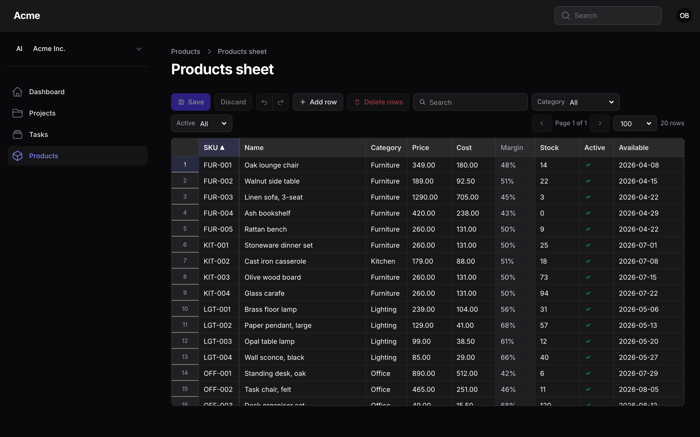

# Filament Spreadsheet

<div class="filament-hidden">


[](https://packagist.org/packages/packstub/filament-spreadsheet)
[](https://github.com/packstub/filament-spreadsheet/actions/workflows/tests.yml)
[](https://packagist.org/packages/packstub/filament-spreadsheet)
[](https://github.com/packstub/filament-spreadsheet/blob/main/LICENSE.md)
[](https://github.com/sponsors/icaliman)

</div>

An **inline-editable table** for bulk editing Eloquent records in Filament: a sheet page for any resource where you edit cells in place with the keyboard, paste rows from Excel or Google Sheets, fill down, undo, and press **Save** once. The server validates every cell with your rules, checks your policies row by row, detects conflicts, and writes the whole batch in one transaction. Edit multiple records at once without a form per record.

## Features

- **[One Save for hundreds of cells](#saving)**: changed cells wait in the browser (across pages, sorting and search) until you press Save or Ctrl+S; the server writes them in one transaction and answers with the rows as saved. `AllOrNothing` (one bad cell, nothing written, every error shown) or `PerRow` (good rows commit, bad rows come back).
- **[Rules, policies and conflicts on the server](#saving)**: Laravel validation rules per column (a `unique` rule ignores the record itself), the model's policy (`update`, `create`, `delete`) or your own closures for every row, and an `updated_at` (or version) check that refuses a row someone else changed since you loaded it. Errors land on the cell, in red, with the message.
- **[Keyboard grid](#editing)**: arrows and Shift+arrows select ranges, Enter or F2 (or just typing) edits, Tab and Enter move, Delete clears, Ctrl+X cuts, **Ctrl+D fills down**, Ctrl+Z / Ctrl+Y undo and redo, Ctrl+S saves. A drag handle fills too.
- **[Paste from Excel or Sheets](#editing)**: a block of cells lands where the selection is, each column reading it its own way ("1 234,50" becomes a number, "yes" a boolean, "Paint" the option with that label, "28/02/2026" a date in your display format); rows past the last one become new records.
- **[Column types](#columns)**: `TextColumn`, `NumberColumn` (integer or decimals, min, max), `BooleanColumn`, `SelectColumn` (options, an enum, or a `relationship()`), `DateColumn`, `DateTimeColumn`, `ComputedColumn` (read-only). Per-column `rules()`, `readOnly()` (for some records only), `default()` for new rows, `hidden()`.
- **[Resource page or standalone page](#installation)**: `SpreadsheetResourcePage` (`/products/sheet`, rows from the resource's query, tenant-scoped, the resource's abilities per row) with a `SheetAction` for the list page, or `SpreadsheetPage` with your own `query()`.
- **Search, sort, filters, pagination on the server** (default 100 rows per page, up to 1,000), with a badge that says "12 changes on 3 pages".
- **Events and hooks**: `RowsSaved` and `RowSaveFailed` events, `beforeSave()`, `afterSave()`, `mutateRowBeforeSave()`.
- **Built on [Tabulator](https://tabulator.info) (MIT)**, bundled: nothing to install beyond `filament:assets`. Dark mode, RTL, translatable (English, Romanian, Russian, German). MIT.

## Editable columns or a sheet?

Filament's editable table columns (`TextInputColumn`, `SelectColumn`, `ToggleColumn`) are perfect for flipping a toggle or fixing one price: one cell, saved as you leave it. This plugin is for the afternoon when you need to fix three hundred of them: the same cells, but edited like a spreadsheet, validated together, checked against your policies, and written in one go. Keep the editable columns on your list page; add a sheet page next to it for the bulk work.

## Compatibility

| Plugin | Filament | Laravel | PHP |
| --- | --- | --- | --- |
| 1.x | 4.13+, 5.x | 12.x, 13.x | 8.3+ |

1.x is built for a desktop browser: keyboard, pointer and clipboard. On a touch screen a sheet can be read, searched, filtered and paged; editing cells by touch is planned.

## Installation

```bash
composer require packstub/filament-spreadsheet
php artisan filament:assets
```

No migrations: the sheet reads and writes your own columns. The config file is optional (`php artisan vendor:publish --tag=packstub-spreadsheet-config`).

A sheet in a minute, next to a resource:

```php
use App\Filament\Resources\Products\ProductResource;
use Packstub\Spreadsheet\Columns\BooleanColumn;
use Packstub\Spreadsheet\Columns\NumberColumn;
use Packstub\Spreadsheet\Columns\SelectColumn;
use Packstub\Spreadsheet\Columns\TextColumn;
use Packstub\Spreadsheet\Pages\SpreadsheetResourcePage;
use Packstub\Spreadsheet\Spreadsheet;

class ProductsSheet extends SpreadsheetResourcePage
{
    protected static string $resource = ProductResource::class;

    public function spreadsheet(Spreadsheet $spreadsheet): Spreadsheet
    {
        return $spreadsheet
            ->columns([
                TextColumn::make('sku')->rules(['required', 'max:32', 'unique:products,sku'])->frozen(),
                TextColumn::make('name')->rules(['required', 'max:120']),
                SelectColumn::make('category_id')->relationship('category', 'name'),
                NumberColumn::make('price')->decimals(2)->min(0),
                NumberColumn::make('stock')->integer()->min(0),
                BooleanColumn::make('is_active')->default(true),
            ])
            ->searchable(['sku', 'name'])
            ->defaultSort('sku')
            ->creatable()
            ->deletable();
    }
}
```

Register it in the resource's `getPages()`: `'sheet' => ProductsSheet::route('/sheet')`, and add `SheetAction::make()` to the list page's header actions to link to it. Rows come from `ProductResource::getEloquentQuery()` (tenant-scoped); each row's update, create and delete go through the resource's `canEdit()`, `canCreate()` and `canDelete()`.

Read more: [Installation](https://packstub.dev/docs/filament-spreadsheet/installation) · [Your first sheet](https://packstub.dev/docs/filament-spreadsheet/first-sheet).

## Columns



A column names an attribute and says how to read and write it. Every write is coerced by its column, validated with its rules and the type's, and refused on the cell when it cannot be read:

```php
TextColumn::make('name')->rules(['required'])->maxLength(120),
NumberColumn::make('price')->decimals(2)->min(0),
NumberColumn::make('stock')->integer()->readOnly(fn (Product $product) => $product->is_locked),
BooleanColumn::make('is_active')->default(true),
SelectColumn::make('status')->options(Status::class),
SelectColumn::make('category_id')->relationship('category', 'name', fn (Builder $query) => $query->where('active', true)),
DateColumn::make('available_on')->format('d/m/Y'),
DateTimeColumn::make('published_at'),
ComputedColumn::make('margin')->formula('price - cost')->decimals(2),   // recomputed in the browser as you type
ComputedColumn::make('orders')->state(fn (Product $product) => $product->orders_count),
```

A `formula()` is a small expression over the sheet's own columns (`if(stock < 5, 'Reorder', 'OK')`, `round(price * 1.2, 2)`, `coalesce(cost, 0)`): the server computes it for every row and the browser again over the unsaved cells, so the value follows an edit, an undo and a paste before Save.

Read more: [Columns](https://packstub.dev/docs/filament-spreadsheet/columns).

## Editing



Click a cell to select it, type to replace it, double-click, Enter or F2 to edit it in place. Enter moves down, Tab moves right, Escape cancels. Shift+arrows select a range; Ctrl+C copies it as tab-separated text (labels for selects, ISO dates), Ctrl+X cuts it, Ctrl+V pastes whatever is on the clipboard, Delete clears it (the cells you may edit), Ctrl+D fills the first row down, and the small handle at the corner of the selection drags to fill. Ctrl+Z and Ctrl+Y walk the history, across pages. Changed cells get an amber corner; a cell the column cannot read ("abc" in a number) is red at once, before you even save.

Read more: [Editing](https://packstub.dev/docs/filament-spreadsheet/editing).

## Saving

Save (or Ctrl+S) sends every changed cell, the new rows and the deletions in one call. The server loads each record through the sheet's query, checks the policy, compares the version, coerces and validates, and writes:

```php
->saveMode(SaveMode::PerRow)                    // or AllOrNothing (the default)
->versionColumn('lock_version')                 // updated_at by default; false to skip the check
->mutateRowBeforeSave(fn (array $data, ?Product $record) => $data + ['updated_by' => auth()->id()])
->beforeSave(fn (SavePayload $payload) => throw_if($payload->rowCount() > 500, new SaveRejected('Save in smaller batches.')))
->afterSave(fn (Collection $products) => ProductIndexer::dispatch($products->modelKeys()))
```

The answer tells the browser which rows went through (with their values after casts and mutators), which cells were refused (the message on the cell), and which rows changed on the server meanwhile (purple, with their value next to yours; save again to win). `RowsSaved` fires after the transaction commits, `RowSaveFailed` for each refused row.

Read more: [Saving](https://packstub.dev/docs/filament-spreadsheet/saving) · [Authorization](https://packstub.dev/docs/filament-spreadsheet/authorization).

## Adding and deleting rows

`->creatable()` shows an Add row button (Ctrl+Enter) and lets a paste past the last row create records; new rows start with the columns' `default()` values and are validated over every column. `->deletable()` lets a row selection (click its number) or the row's context menu mark rows for deletion; they go with the next Save. Both are gated by the policy (`create`, `delete`) or your `authorizeCreate()` / `authorizeDelete()` closures.

Read more: [Adding and deleting rows](https://packstub.dev/docs/filament-spreadsheet/rows).

## Search, sort, filters, pagination

Everything the toolbar does happens on the server: the search box looks in `searchable([...])`, a header click sorts by that column, `filters([...])` are small selects (or date ranges) applied to the query, and the page size runs from 25 to 1,000 rows. Unsaved cells stay in the browser through all of it: the badge says how many and on how many pages.

```php
->searchable(['sku', 'name', 'category.name'])
->defaultSort('sku')
->perPage(200)
->filters([
    Filter::select('category_id')->options(fn () => Category::pluck('name', 'id')->all()),
    Filter::boolean('is_active'),
    Filter::dateRange('available_on'),
])
```

Read more: [Search, sort, filters, pagination](https://packstub.dev/docs/filament-spreadsheet/browsing).

## Configuration

`config/packstub-spreadsheet.php` holds the defaults: rows per page and the maximum, the most rows one Save may carry, the save mode, the version column, whether leaving with unsaved changes asks first, the frozen first column, the row height, the keyboard shortcuts and the date formats.



The stylesheet maps Tabulator's surfaces to Filament's colour variables, follows dark mode and reads right-to-left with the panel. Restyle it with the `--ps-sheet-*` variables on `.ps-sheet`.

Read more: [Styling](https://packstub.dev/docs/filament-spreadsheet/styling).

## Documentation

- [Installation](https://packstub.dev/docs/filament-spreadsheet/installation)
- [Your first sheet](https://packstub.dev/docs/filament-spreadsheet/first-sheet)
- [Columns](https://packstub.dev/docs/filament-spreadsheet/columns)
- [Editing](https://packstub.dev/docs/filament-spreadsheet/editing)
- [Saving](https://packstub.dev/docs/filament-spreadsheet/saving)
- [Adding and deleting rows](https://packstub.dev/docs/filament-spreadsheet/rows)
- [Search, sort, filters, pagination](https://packstub.dev/docs/filament-spreadsheet/browsing)
- [Authorization](https://packstub.dev/docs/filament-spreadsheet/authorization)
- [Tenancy](https://packstub.dev/docs/filament-spreadsheet/tenancy)
- [Events and hooks](https://packstub.dev/docs/filament-spreadsheet/events)
- [A sheet outside a resource](https://packstub.dev/docs/filament-spreadsheet/standalone)
- [Styling](https://packstub.dev/docs/filament-spreadsheet/styling)
- [Performance](https://packstub.dev/docs/filament-spreadsheet/performance)
- [Editable columns vs a sheet](https://packstub.dev/docs/filament-spreadsheet/comparison)
- [Upgrading](https://packstub.dev/docs/filament-spreadsheet/upgrading)

The same pages live in the [`docs/`](https://github.com/packstub/filament-spreadsheet/tree/main/docs) directory of this repository.

## Testing

```bash
composer test      # the Pest suite
composer test:js   # the browser side's pure parts (TSV, coercion, the buffer, undo, paste) on plain Node
```

## Changelog

See the [changelog](https://github.com/packstub/filament-spreadsheet/blob/main/CHANGELOG.md).

## Security vulnerabilities

Please e-mail [support@packstub.dev](mailto:support@packstub.dev) rather than opening a public issue.

## Credits

- [Ion Caliman](https://github.com/icaliman)
- [Tabulator](https://github.com/tabulator-tables/tabulator) by Oli Folkerd, the grid engine (MIT)
- [All contributors](https://github.com/packstub/filament-spreadsheet/contributors)

## License

MIT. See the [license file](https://github.com/packstub/filament-spreadsheet/blob/main/LICENSE.md).

Search terms: filament inline edit table, filament editable table, filament bulk edit records, filament edit multiple records, filament spreadsheet, filament excel like editing, filament paste from excel, filament TextInputColumn save button, laravel spreadsheet editor livewire, filament grid editor, filament datasheet.
