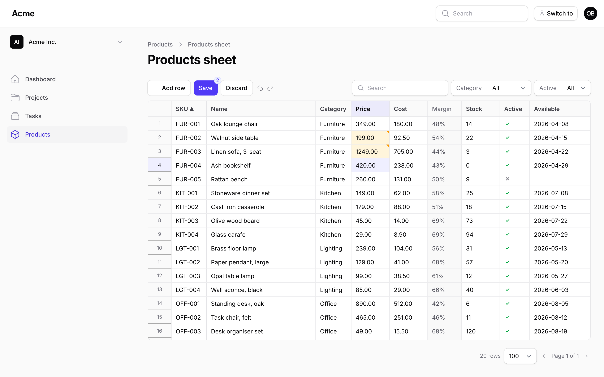

# Editing

## Keyboard

| Keys | What happens |
| --- | --- |
| Click, arrows | Select a cell |
| Shift + arrows, Shift + click, drag | Select a range |
| Ctrl + ↓ / Ctrl + ↑ | Jump down / up the column to the edge of its filled cells (a 0 or an unticked box is a filled cell; the last / first row of the page in a filled column), scrolled into view; with Shift the range extends there |
| Click a row number | Select the row (for deletion) |
| Enter, F2, double-click, or just typing | Edit the cell (typing replaces its content, Enter/F2 keep it) |
| Enter while editing | Commit and move down |
| Tab / Shift + Tab while editing | Commit and move right / left |
| Escape | Cancel the edit (the menu, too) |
| Delete, Backspace | Clear the selected cells (the ones you may edit: a locked, read-only or computed cell stays) |
| Enter, Space or a double-click on a boolean | Flip it |
| Ctrl + C | Copy the selection as tab-separated text (labels for selects, ISO dates, TRUE/FALSE) |
| Ctrl + X | Cut: copy the selection, then clear the cells you may edit |
| Ctrl + V | Paste at the selection (see below) |
| Ctrl + D | Fill the first row of the selection down into the rows below |
| Drag the small square at the selection's corner | Fill neighbouring cells |
| Ctrl + Z, Ctrl + Y (or Ctrl + Shift + Z) | Undo, redo — edits, pastes, fill-downs, new rows and deletions, across pages |
| Ctrl + S | Save |
| Ctrl + Enter | Add a row (when the sheet is creatable); the selection moves to its first editable cell. In an open editor it commits the cell first |
| Right-click a row | The row menu (delete / keep) |

`mod` is Ctrl on Windows and Linux, ⌘ on macOS. The **?** button at the end of the toolbar lists every shortcut as it is bound on this sheet, in a modal. The shortcuts for save, fill-down, undo, redo, add-row and cut can be changed in the config (`keybindings`); the toolbar's tooltips show each one as it is bound, with ⌘ on a Mac. Ctrl+S works anywhere in the sheet, and with an editor still open it takes what you typed first (Save does the same on a click), so the cell you are in is part of the save; every other shortcut applies while the grid has the focus, so in the search box or a filter Ctrl+Z undoes your typing, not the sheet. A toolbar button hands the keyboard back to the grid: after a click on Undo, Ctrl+Y redoes; after Add row, what you type goes into the new row (the selection is on its first editable cell, scrolled into view), and Ctrl+Z takes the row away. A click into the search box or a filter while you are typing in a cell keeps what you typed as a change and puts the caret where you clicked.

## Keys inside an open editor

While a cell is being edited, the keys belong to its editor first. What each one does depends on the column's type:

| Keys | Text, number | Date, date-time | Select |
| --- | --- | --- | --- |
| Enter | Commit and move down | Commit and move down | Pick the highlighted option and move down |
| Tab / Shift + Tab | Commit and move right / left | Commit and move right / left | Close the list without picking and move right / left |
| Escape | Cancel | Cancel | Cancel |
| ↑ / ↓ | Commit and move up / down | Step the focused part (day, month, year, hour, minute) | Move through the options |
| ← / → | Move the caret | Move to the previous / next part | Move the caret in the search text |
| Home / End | Caret to the start / end of the text (with Shift: select to there) | Nothing | Caret to the start / end of the search text |
| Page Up / Page Down | Nothing | Nothing | Nothing |
| Backspace, Delete | Delete text | Clear the focused part | Delete search text |

Enter, Tab and ↑ / ↓ select the neighbouring cell without opening its editor, so a column of numbers is typed as in a spreadsheet: a value, ↓, a value, ↓. None of these keys scrolls the grid away from the cell you are in: Page Up, Page Down, Home and End act on the grid again once the editor is closed.

A date or a date-time can be typed part by part (the order of the parts follows the browser's locale), after Enter or F2 or straight on the selected cell: the first digit opens the editor and goes into its first part, any other key just opens it. The editor stays open until Enter, Tab or a click elsewhere commits what it holds, and Escape leaves the cell as it was. A date picked from the browser's calendar is committed at once. An incomplete date (one part cleared, a year not typed yet) leaves the cell as it was: clear every part, or press Delete on the selected cell, to empty it.

A select opened with Enter, F2 or a double-click lists every option, with the current label selected in the search field: ↑ / ↓ and Enter pick another option, a typed letter replaces the label and searches the list (then ↓ and Enter pick from what is left; once ↑ / ↓ have moved the highlight, Tab or a click elsewhere pick the highlighted option too). Typed text confirmed with Enter, Tab or a click elsewhere is matched to an option by its label or its key, case and spaces aside, as a pasted value is: "kitchen" picks Kitchen, and a label that is also another option's key picks the option it labels; text that matches nothing stays on the cell, painted red, until it is fixed or undone. Typing on the selected cell opens the list already searched by that letter. The list has no empty item: clearing the search field and confirming (Enter, Tab or a click elsewhere) empties the cell, as Delete on the selected cell does. Escape leaves the cell as it was, so clear the field to look at every option and press Escape if you only wanted to look.

## Paste from Excel, Google Sheets or Numbers

Copy a block in your spreadsheet, select the top-left cell in the sheet, Ctrl+V. The block lands there, column by column, each cell read by the column's type ([Columns](columns.md)): `1 234,50` becomes 1234.5 in a number column, `Paint` the option with that label in a select, `yes` a tick, `28/02/2026` a date when the column shows `d/m/Y`. Quoted cells (a newline inside a cell) are read the way Excel writes them.

- A cell that cannot be read (`abc` in a number) is pasted as it is and painted red at once, with the reason on hover and, when it is the active cell, in the line under the grid, in a new row too; the server would refuse it too. Fix it or undo.
- A cell that cannot be edited (a read-only column, a locked cell, a row you may not update) is skipped; the toolbar says how many were.
- Columns past the last one are ignored; rows past the last one become **new rows** when the sheet is `creatable()`, starting from the columns' defaults. New rows stop at the config's `max_rows_per_save` (2,000 by default, counting the changed and deleted rows too), and the toolbar says how many lines were left out: save, then paste the rest.
- A line with nothing on it past the last row makes no new row (a blank row copied along would only be refused by a `required` rule); inside the existing rows it clears the cells it lands on.
- The block lands column by column from the anchor, computed and read-only columns included: a block copied from a sheet that has no `Margin` column, pasted over a sheet whose `Margin` sits between `Cost` and `Stock`, puts its sixth column on `Margin` (skipped, counted in the toolbar) and the rest one column to the right. Paste in two blocks around a computed column, or keep the computed columns at the end of the sheet.
- One copied cell pasted over a selection fills the whole selection, as in Excel.
- A paste is one step for undo: Ctrl+Z takes the whole block back, the rows it created included.

## Fill down

Select a range whose first row holds the values you want, press Ctrl+D: every column of the range copies its first cell into the rows below, where the cell may be edited. Or drag the handle at the bottom-right corner of the selection.

## What a changed cell looks like

A changed cell keeps an amber corner until it is saved (or undone, or changed back to what the server sent, which is not a change at all). The toolbar counts them, and the pages they sit on: sorting, searching, filtering or paging never loses them. A red cell is one the column or the server refused, a purple one changed on the server while you were editing ([Saving](saving.md#conflicts)); the message is on hover and, for the active cell, in the line under the grid (their value next to yours for a conflict), so it is readable from the keyboard and on a touch screen. The toolbar's "4 cells need attention" is a button: each press moves the active cell to the next marked cell of the page, wrapping around; when the marked cells are on other pages it says so. A refused cell carries `aria-invalid`, the sorted header `aria-sort`, and the line under the grid is a live region, so a screen reader hears the save and paste messages and the active cell's error.

## While a save is in flight

From Ctrl+S until the answer lands the sheet takes no edits: the grid is dimmed, the pointer shows progress, no editor opens, and a paste, fill-down, undo, new row or deletion does nothing. What is typed meanwhile is dropped, not queued (the answer replaces the saved cells with what the server wrote, and an edit made in between would have been lost with them). A save takes a moment only for a big batch or a slow connection; editing resumes the instant it is answered, and the toolbar buttons follow. A save that never reaches the server (the connection dropped, the session expired, a proxy answered instead) releases the sheet too, with everything unsaved still in place: see [Saving](saving.md#when-the-request-fails).

## Leaving the page

With unsaved changes, closing the tab or navigating away (Livewire's navigate too) asks first (`confirm_leave` in the config). Text in a cell you are still typing in counts as one. Back or Forward cancelled at that question returns to the sheet's own address in browsers with the Navigation API (Chrome, Edge, Safari 26.2+, Firefox 147+); in others the address bar keeps the other page's address until you leave. Discard drops everything unsaved after a confirmation; the grid stays where it was scrolled to and the active cell where it was.
